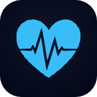
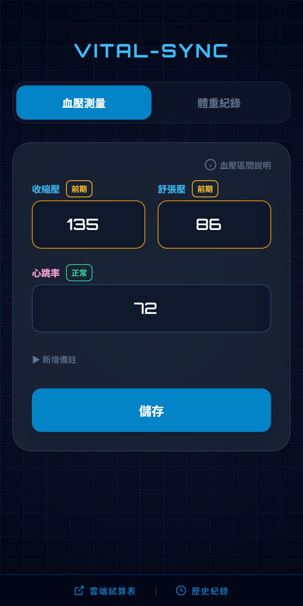
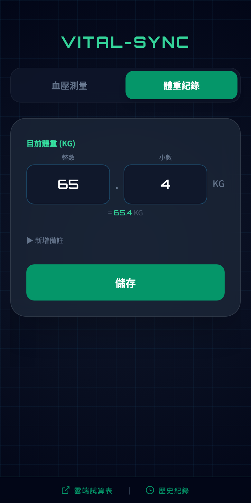
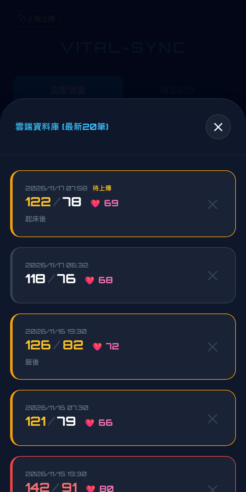

# VITAL-SYNC

**以手機記錄血壓與體重，資料直接存入您自己的 Google 試算表**

&nbsp;
&nbsp;

## ✨ 特色

- 🔒 **資料由您保管**：紀錄只存放於您自己的 Google 雲端硬碟，開發者無從取得。
- 📶 **無網路亦可記錄**：紀錄先保存於手機，恢復連線後自動上傳。
- ⚡ **輸入迅速**：數字填滿即自動跳至下一欄，並即時標示血壓等級。
- 📱 **可加入主畫面**：加入後的使用方式與一般 App 相同。
- 🆓 **完全免費**：無須註冊、無須安裝，亦無廣告。

## 🚀 快速開始

1. 開啟[網站](https://pp771007.github.io/vital-sync/)，點選「**使用 Google 帳號登入**」。
2. 點選「**允許存取試算表**」，並於 Google 的授權畫面中按下同意。
3. 系統將於您的雲端硬碟自動建立名為「**VITAL-SYNC**」的試算表，此後所有紀錄均存放於其中。

完成首次登入後，再次開啟網站即會直接進入輸入畫面。

### 加入手機主畫面

- **Android**：以 Chrome 開啟網站，於瀏覽器選單中點選「加入主畫面」或「安裝應用程式」。
- **iPhone**：以 Safari 開啟網站，點選「分享」按鈕，再點選「加入主畫面」。

加入後，點選主畫面上的圖示即可直接開啟，無須再輸入網址。

## ✍️ 使用方式

- **血壓**：依序輸入收縮壓、舒張壓與心跳。數字填滿後會自動跳至下一欄，按退格鍵可返回上一欄；欄位旁會即時標示等級，外框顏色亦隨之改變。
- **體重**：整數與小數分兩欄輸入。例如 65.4 公斤，請於左欄輸入 `65`、右欄輸入 `4`。
- **備註**：點選數字下方的「▶ 新增備註」，可附註「飯後」、「運動後」等說明。
- **切換頁面**：點選上方的「血壓測量」或「體重紀錄」，亦可左右滑動畫面。
- **歷史紀錄**：點選下方的「歷史紀錄」，可檢視最近 20 筆；點選右側的 × 可刪除該筆紀錄。
- **完整資料**：點選下方的「雲端試算表」即可開啟 Google 試算表，自行排序、製作圖表或匯出。

> [!CAUTION]
> 紀錄刪除後無法復原。

## 📶 無網路時的使用方式

曾經登入並已加入主畫面者，即使沒有網路，仍可開啟網站並記錄血壓與體重。

1. 按下「儲存」後，紀錄會先保存於手機，畫面左上角顯示「**待上傳**」及筆數。
2. 恢復連線後，紀錄會自動上傳。試算表中的時間以按下「儲存」的時間為準，不受上傳時間影響。
3. 若離線時間較久，系統可能需要重新確認您的 Google 帳號。此時請點選「待上傳」，依畫面指示完成後即可上傳。

首次登入、檢視完整歷史紀錄、刪除已上傳的紀錄，以及開啟試算表，仍須連上網路。

> [!IMPORTANT]
> 尚未上傳的紀錄僅存放於該支手機。登出、更換手機或清除瀏覽器資料前，請先確認「待上傳」已經消失。

## 🩺 血壓分級對照

| 等級 | 收縮壓 | 舒張壓 |
|---|---|---|
| 偏低 | < 90 | < 60 |
| 正常 | 90 – 119 | 60 – 79 |
| 前期 | 120 – 139 | 80 – 89 |
| 一期 | 140 – 159 | 90 – 99 |
| 二期 | ≥ 160 | ≥ 100 |

心跳：低於 60 為偏慢，60 – 100 為正常，高於 100 為偏快。

> [!WARNING]
> 上述數值僅供自我記錄參考，不能取代醫師診斷。身體不適時，請儘速就醫。

## 🔐 資料與隱私

**您的紀錄只會存放於您自己的 Google 雲端硬碟。** 本網站沒有自己的伺服器與資料庫；按下「儲存」後，資料會由您的手機直接傳送至您的試算表，開發者無法檢視或取得。

- **權限範圍**：本網站僅申請「存取本網站所建立的檔案」一項權限，無法讀取您雲端硬碟中的其他檔案、相片或郵件。
- **資料正本**：「VITAL-SYNC」試算表即為資料正本，可自由更名、移動資料夾、排序或製作圖表，本網站仍能正常找到該檔案。
- **收回權限**：前往 Google 帳戶的「[與第三方應用程式和服務的連結](https://myaccount.google.com/connections)」，移除本網站即可。
- **刪除資料**：將該試算表移至垃圾桶即可。

完整說明請參閱[隱私權政策](https://pp771007.github.io/vital-sync/privacy.html)與[服務條款](https://pp771007.github.io/vital-sync/terms.html)。

## ❓ 常見問題

<b>更換手機或電腦後，仍可看到過去的紀錄嗎？</b>

可以。紀錄存放於 Google 試算表中，以同一個 Google 帳號登入即可檢視。

<b>沒有網路時可以使用嗎？</b>

可以記錄。紀錄會先保存於手機，恢復連線後自動上傳，詳見上方「無網路時的使用方式」。

<b>可以直接在試算表中修改數值嗎？</b>

可以，該試算表屬於您。惟請勿更改分頁名稱（「血壓紀錄」、「體重紀錄」）及第一列的欄位標題，以免本網站無法讀寫。

<b>為什麼歷史紀錄只顯示 20 筆？</b>

該畫面僅供快速檢視。全部紀錄均存放於試算表中，點選「雲端試算表」即可查看。

